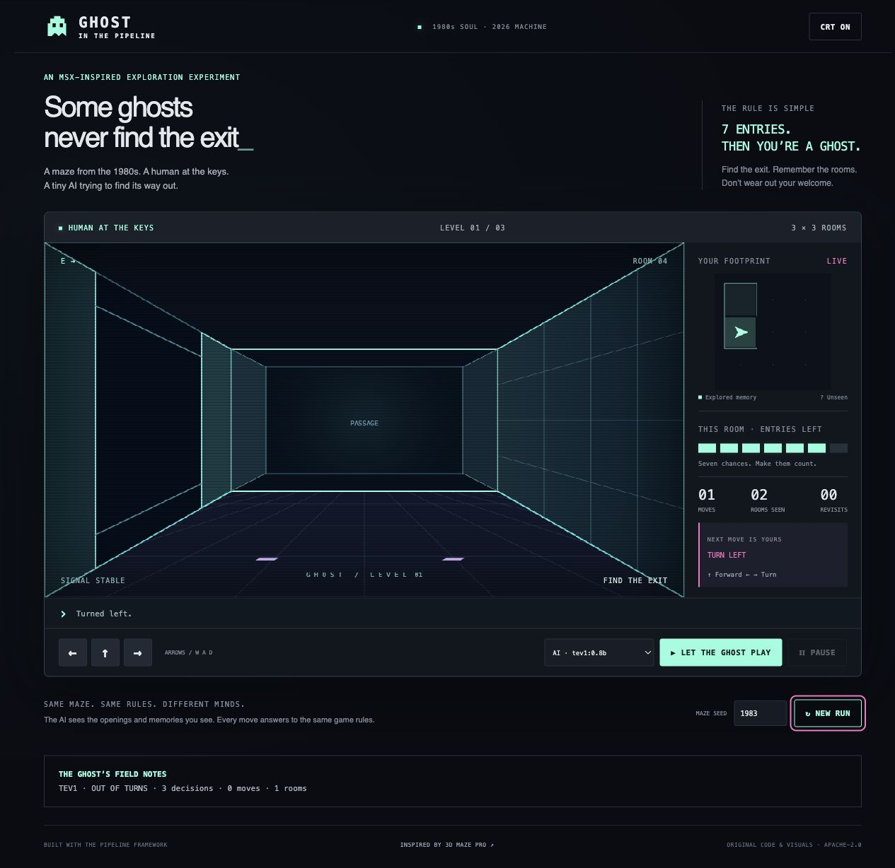

# Ghost in the Pipeline 👻

**A maze from the 1980s, a Java framework from 2026, and an AI trying to find its way out.**

An independently implemented, MSX-inspired first-person maze built with [The Pipeline Framework](https://pipelineframework.org/). Play with the keyboard, hand control to a real local Tev1 decision model, or compare it with Random and a deterministic Explorer. Seven entries per room; three growing levels; no hidden map for the AI.



## Run locally

Requirements: Java 21+, Maven 3.9+, Python 3 for the helper scripts, and Ollama with its decision API. The recorded run used Java 25 while compiling Java 21-compatible code. Dependencies and model weights need an initial download; gameplay then runs locally without a cloud account, CDN or hosted inference service.

```sh
ollama pull tev1:0.8b
# Start Ollama if it is not already running.
./scripts/run.sh
```

Open **http://127.0.0.1:8087**. Use **↑ / W** to walk, **← / A** and **→ / D** to turn. Play/Pause hands control to the selected automated player; Pause finishes at most the current turn. Reset restarts the selected seed. An observed-only map and entry bars help you keep your bearings.

The levels are 3×3, 4×4 and 6×6. Each room starts with seven entries; entering decrements its allowance and reaching zero loses. Spawning, turning and bumping into a wall consume none. Cross the exit to advance; escape the third level to win. Every admitted level is checked for a valid escape under these same rules.

A second launch can reuse the package with `./scripts/run.sh --no-build`. Change the port with `GHOST_PORT=8089`. A compatible local model/endpoint can be selected with `GHOST_MODEL` and `GHOST_MODEL_URL`; the launcher writes a native TPF deployment binding through `PIPELINE_CONFIG`. The supplied host connection is for local Ollama, not hosted credential management.

## Test and compare

```sh
mvn -B -ntp verify
mvn -B -ntp verify -Dghost.live=true  # Includes real Tev1 inference; Ollama must be running.

# With the application running:
python3 scripts/evaluate.py
./scripts/recording-reset.sh
```

The ordinary test suite uses real TPF gameplay and observation-only baselines. The opt-in live test validates genuine model decisions without requiring an escape or an exact action. The completed delivery run passed **16 tests**, including human completion of all three levels, pause, limits, action validation and live Tev1. Core tests validate **600 seeded levels**.

Evaluation uses the same nine seed/level combinations for all players, with 128 decisions and 120 seconds per case. For timings without the visual pause, restart with `GHOST_PACE_MS=0 ./scripts/run.sh --no-build`, then run `GHOST_PACE_MS=0 python3 scripts/evaluate.py`. Do not interact with that single session during evaluation. The script leaves a fresh normal campaign ready afterwards.

| Player | Escaped | What actually happened |
|---|---:|---|
| Tev1 0.8B | 0 / 9 | Repeated forward attempts, mostly rejected by walls |
| Random legal movement | 1 / 9 | Occasionally escaped; also exhausted rooms or its action budget |
| Deterministic Explorer | 9 / 9 | Used visited-room memory and depth-first exploration |

These are small-sample observations, not a general model ranking. The maze and seeds were not adjusted to make Tev1 win. Full actions, latencies and paired starting observations are in [the evaluation dataset](evidence/evaluation.json); see [the report](docs/evaluation.md) for definitions and limits.

## How it works

One bounded TPF execution owns each automated Play segment. Typed recursive composition makes the next turn; a native Decision Query asks Tev1 for one action; the same reducer used by human play validates it. A native Command publishes the frame. The model has no state-write authority.

The model receives visited rooms, observed walls/passages/exits, entry allowances, orientation and the prior result. It does not receive unseen topology, the maze seed, the validation witness or a computed route. Explorer uses those same observations, not the solver.

See [architecture](docs/architecture.md), [execution contract](docs/execution-contract.md), and [bounded qualification](docs/qualification.md). Published TPF snapshot binaries are pinned by timestamp; [dependency identities and SHA-256 values](evidence/dependencies.json) record what was exercised. No TPF runtime changes were made. MCP was unnecessary and is omitted.

## Record and inspect

The primary deliverable is the game. Follow [the 60–90-second recording sequence](docs/recording.md); [the DEV submission](docs/dev-submission.md) is a draft, with the final video and reviewed session link still to insert. No video was recorded or uploaded automatically.

Native replay goes to `target/replay/` by default. Set `GHOST_REPLAY_PATH` to an absolute directory for a separate run. [The execution dataset](evidence/README.md) includes representative native documents and root/lineage verification:

```sh
python3 scripts/verify-replay.py evidence/replay
```

Meaningful commits are captured by the repository's existing Entire session tooling. See [development evidence](docs/development-evidence.md). Checkpoints remain local and require privacy review before sharing. Nothing is pushed or published automatically.

## Historical provenance and boundaries

Inspired by [antor44's 3D Maze Pro](https://github.com/antor44/3dmaze). [The comparison](docs/historical-reference.md) documents inspected mechanics, differences and optional emulator instructions. No historical source, graphics, music, binary, ROM or firmware is bundled or required.

Original contributions use **Apache-2.0**. Upstream redistribution rights remain unresolved; that license claim does not extend to historical material or model weights. Read [NOTICE.md](NOTICE.md).

This is a loopback-only, single-session, in-memory demo. Restart loses progress. [Limitations and follow-on work](docs/limitations.md) describe the boundary; there is no cloud deployment, multiplayer, training system or production infrastructure.
