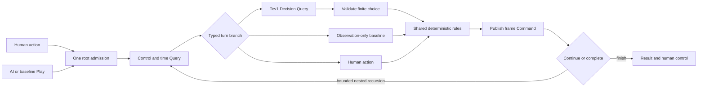

# A small game with a framework-owned loop

The application packages one Quarkus process and serves its own static browser UI. `connectors` is a build-time dependency containing immutable game values, pure rules and the tiny local session connector; `app` owns the pipeline, authored steps and HTTP host. Two Maven modules do not mean two running services.

TPF's existing `decision.query.jev` provider makes one decision request to Ollama. Its canonical request contains only an explicitly constructed observation. The completion projection carries trusted run state alongside the result; the model cannot replace it. Typed unions route model, action and complete branches, and native recursive composition owns iteration.

`Rules` implements seeded generation, independent solvability admission, movement, entry exhaustion, progression and victory. Human, Tev1, Random and Explorer all reach the same reducer. The solver witness is used for level admission and human test fixtures only. It is absent from the UI/API observations, model request and baseline selectors.

Memory records visited rooms, visits, remaining entry allowance and observed edges. Front, left and right edges become known on observation; a traversed rear passage is known from the movement itself. Turning can reveal the previously unseen rear. The first-person renderer and explored map use this same projection. `#` is a wall, `.` a passage, `E` an observed exit, and `?` unknown. Room identities are row-major; unseen connectivity and exit location remain private.

The host owns one in-memory session. Admission serializes player ownership and checks expected revision. Publication is a native Command with a generation/segment/revision effect identity. Reset invalidates old segments; their late responses cannot overwrite the new game. Pause finishes at most an in-flight turn and returns through a typed base case. A separate outer watchdog invalidates ownership if a segment times out.

Each automated segment is capped at 128 decisions and 120 seconds; every translation requires a decision. Requests time out after ten seconds, retries are disabled, and TPF recursion has a separate depth bound. Rendering pace is host presentation behavior, disabled during the recorded comparison. It is excluded from decision latency.

The native model binding is deployment configuration. `scripts/run.sh` supplies a native `PIPELINE_CONFIG` file with the chosen model and endpoint. No custom agent runtime, inference proxy, model-side tools, persistence, cloud service or MCP server is involved.

See [execution-contract.md](execution-contract.md) for root/lineage expectations and the bounded compiler-shape adaptation. Native replay documents remain unchanged; the verifier checks identity, nesting lifetime and ordering rather than asserting a particular file count.
