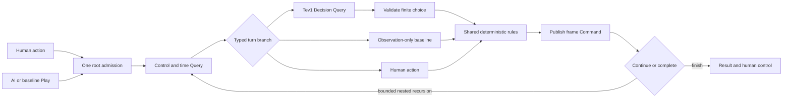

# A small game with a framework-owned loop

The application packages one Quarkus process and serves its own static browser UI. `connectors` is a build-time dependency containing immutable game values, pure rules and the tiny local session connector; `app` owns the pipeline, authored steps and HTTP host. Two Maven modules do not mean two running services.

TPF's existing `decision.query.jev` provider makes one decision request to Ollama. Its canonical request contains only an explicitly constructed observation. The completion projection carries trusted run state alongside the result; the model cannot replace it. Typed unions route model, action and complete branches, and native recursive composition owns iteration.

Optional haunted clues add two small canonical values: `NavigationSignal` and visited `SignalReading` records, carried in immutable `RunState` alongside the segment's `agentClues` flag. A pure calculator uses shortest corridor distance to assign one of four bands; exact distances remain local. The shared action transformation updates readings after movement. Turning/bumping produces `NO_MOVEMENT`, and level changes reset the sensory memory. No new Query, Command, root or agent subsystem is introduced. With the flag off, model input omits both signal data and explanatory signal instructions.

Human glow/HUD and the original Web Audio synth consume that same published signal. Their independent browser switches do not affect rules or inference inputs. Audio is opt-in, uses conservative gain, and cleans up on mute/reset/end/page exit. [The haunted-sense report](haunted-sense.md) documents thresholds, experiment controls and the actual audiovisual recording.

The player menu selects `TEV1` or `TEV1_4B` at segment admission. `ChooseTurn` emits distinct nominal `ModelTurn` and `LargeModelTurn` values, so native typed routing selects the `model` or `model4b` binding. Both Queries produce `Chosen` and join the same choice validation, rules and publication path. Each turn invokes one model; choosing 4B creates no additional root execution. The default 4B binding is `tev1:latest`, locally reported as 4.2B / mxfp8. Tags remain explicit in frame metadata and evaluation records.

`Rules` implements seeded generation, independent solvability admission, movement, entry exhaustion, progression and victory. Human, Tev1, Random and Explorer all reach the same reducer. The solver witness is used for level admission and human test fixtures only. It is absent from the UI/API observations, model request and baseline selectors.

Memory records visited rooms, visits, remaining entry allowance and observed edges. Front, left and right edges become known on observation; a traversed rear passage is known from the movement itself. Turning can reveal the previously unseen rear. The first-person renderer and explored map use this same projection. `#` is a wall, `.` a passage, `E` an observed exit, and `?` unknown. Room identities are row-major; unseen connectivity and exit location remain private.

`relativeEdges` appends plain-language front/left/right facts derived from that current observed edge string and orientation. It adds no topology or route. The compact observation, memory, question instructions and finite action criteria remain in place, allowing an isolated comparison with the original encoding.

The original canvas geometry now uses a perspective camera with continuous yaw. A committed quarter turn animates for 280 ms: the room, floor grid and observed-map arrow rotate together, with a brief old-to-new heading cue. It never renders neighboring cells. Reset and level/room changes cancel a pending rotation; reduced-motion preferences select an instant turn. Rendering changes no game actions or entry allowances. `node scripts/test-renderer.cjs` checks intermediate geometry, direction wraparound, cancellation, reduced motion and clipping at every degree.

A successful forward step adds a 220 ms approach within the newly committed room and a small vertical footstep bob. Collisions stay in place. Reset, another frame transition or reduced motion cancels/snaps the presentation; it does not move authoritative state or reveal an adjacent cell.

The host owns one in-memory session. Admission serializes player ownership and checks expected revision. Publication is a native Command with a generation/segment/revision effect identity. Reset invalidates old segments; their late responses cannot overwrite the new game. Pause finishes at most an in-flight turn and returns through a typed base case. A separate outer watchdog invalidates ownership if a segment times out.

Each automated segment is capped at 128 decisions and 120 seconds; every translation requires a decision. Requests time out after ten seconds, retries are disabled, and TPF recursion has a separate depth bound. Rendering pace is host presentation behavior, disabled during the recorded comparison. It is excluded from decision latency.

The native model bindings are deployment configuration. `scripts/run.sh` supplies a native `PIPELINE_CONFIG` file with both models and the endpoint. Menu selection uses the existing typed pipeline branches. No custom agent runtime, inference proxy, model-side tools, persistence, cloud service or MCP server is involved.

See [execution-contract.md](execution-contract.md) for root/lineage expectations and the bounded compiler-shape adaptation. Native replay documents remain unchanged; the verifier checks identity, nesting lifetime and ordering rather than asserting a particular file count.
