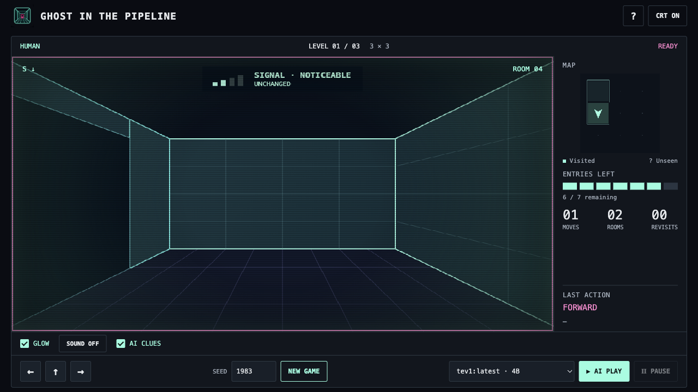
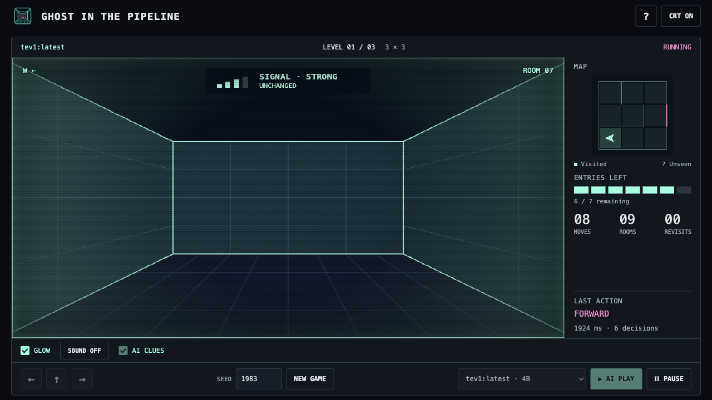

# Forward instruction and compact game UI

The new `forward-first-v2` question adds exactly one instruction to the preceding action-focused prompt:

> If front is open passage, choose FORWARD. Do not keep turning when the corridor ahead is open.

The wall and exit instructions, criterion labels/order, clue explanation and observation fields remain unchanged. This is an instruction to the actual finite-choice model, not an action filter or scripted route. [The exported typed request](../evidence/forward-prompt-definition.json) preserves both clue settings.

## Same cases, honest outcomes

Fixed seeds 1983, 1986 and 2026; as in the preceding experiment, 0.8B covers all three level sizes (nine cases per arm), while 4B covers 3×3 only (three per arm). Each case has 128 decisions, 120 seconds, ten-second provider timeout, no retries and no visual pacing. All 24 attempts completed and are retained. Models ran sequentially. Local timing includes ordinary desktop/build activity and is not a speed benchmark.

Numbers below are **previous action-focused question → new forward-first question**. Rooms are summed distinct rooms across separate trials.

| Model / scope | AI clues | Escapes | Moves | Wall collisions | Rooms |
|---|---|---:|---:|---:|---:|
| 0.8B · 9 cases | Off | 0/9 → 0/9 | 4 → 4 | 136 → 1022 | 13 → 13 |
| 0.8B · 9 cases | On | 0/9 → 0/9 | 4 → 10 | 6 → 1038 | 13 → 17 |
| 4B · 3 cases | Off | 1/3 → 1/3 | 96 → 82 | 0 → 0 | 24 → 22 |
| 4B · 3 cases | On | 1/3 → 1/3 | 68 → 68 | 0 → 0 | 22 → 22 |

Escape counts did not improve. Without clues, 0.8B still made only four moves; with clues it made ten and explored four additional summed rooms, but wall collisions increased sharply in both arms. It remains unreliable at following the combined wall/open-passage instructions. All its attempts exhausted the decision budget, without room-entry losses.

4B still timed out on 1983, escaped 1986, and exhausted a room on 2026 in both arms. The new off-clue 1986 escape took 11 decisions / 7 moves versus 39 / 23 previously; that individual improvement did not produce more escapes overall. The new totals were 148 decisions without clues and 122 with clues, with no wall collisions. Median latency was 9 ms for 0.8B in both arms and 1400.5 / 1824.5 ms for 4B off/on. Full action, revisit, exhaustion and timing records are in `evidence/forward-*-off/on.json` and their comparison summaries. Random and Explorer baselines remain preserved, unchanged, from the previous experiments.

Earlier results are untouched. [0.8B old/new controls](../evidence/forward-08b-prompt-comparison.json), [4B old/new controls](../evidence/forward-4b-prompt-comparison.json), and [build verification](../evidence/polish-build.json) confirm identical starts, rules, signals, baseline classes, model identities and budgets. The non-question observation implementation is unchanged. `pipeline.yaml` is byte-identical to the previous delivery.

## UI polish

The hero, taglines, promotional footer and narrative status copy are removed. The header uses the owner-supplied portal PNG and game name, with Help and CRT controls at the right. The same PNG is the favicon; browser checks verify visible pixels at 16 and 42 pixels. The asset was renamed `portal.png` without changing its bytes; provenance is in `NOTICE.md`.

The first-person view begins 104 pixels from the top at 1280×720. Map, entry allowance, signal, moves, rooms, revisits, last action and measured latency remain visible. Model selection, movement, New Game, glow, sound and AI controls fit in the recording frame. Actual model identifier and run status come directly from the current frame; no model reasoning is invented. Help contains concise movement, exit, entry-limit, signal and AI instructions. It closes with Close or Escape and restores maze focus.

WebKit and Chromium checks pass for the layout, favicon/branding, all four player choices, keyboard focus, Help isolation, clue/audio controls, pause states, reset and terminal controls. The Java suite passed all 22 tests with genuine inference from both models. Renderer/motion, audio lifecycle and native root/lineage checks passed. A separate real UI run exercised 4B Play, Pause and resume; its records are explicitly separate from the evaluation matrix. [Acceptance](../evidence/polish-acceptance.json).

Run `./scripts/run.sh`, then open http://127.0.0.1:8087. Press `?` in the header for instructions. For new comparisons use `scripts/evaluate.py` with fresh `--out` filenames; its default is now `evaluation-forward-prompt.json`. The existing video is retained as historical footage of the earlier UI. Nothing was published automatically.
