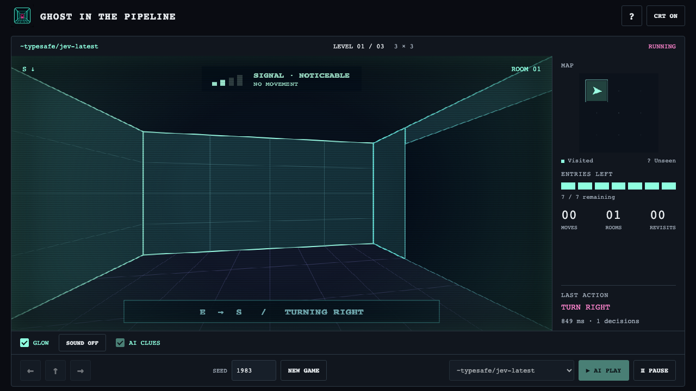

# Hosted Jev, same maze

Jev is now a menu option, using `decision.query.jev`, the supplied `~typesafe/jev-latest` binding and `openrouter-primary`. The host loads `OPENROUTER_API_KEY` from `.env.local` through the launcher; neither the browser nor pipeline values receive it. Local Tev1, human play and baselines remain available without hosted credentials.

The game, prompt, observations and budgets are unchanged from `ordered-policy-v3`. Every action is genuinely selected by the model and validated through the existing shared rules. The only flow extension is a nominal Jev branch into another native Decision Query inside the same recursive Play root. No TPF changes or new dependencies were needed.

## Results

Seeds **1983, 1986, 2026**, each at **3×3, 4×4, 6×6**. One fresh attempt per case and clue setting; 128 decisions, 120 seconds, ten-second provider timeout, no retries, zero presentation delay. Failed attempts are retained.

| Jev | Escaped | Decisions | Moves | Wall collisions | Revisits | Rooms, summed | Entry exhaustion | Provider failures | Median decision latency |
|---|---:|---:|---:|---:|---:|---:|---:|---:|---:|
| Clues off | 8/9 | 235 | 138 | 0 | 11 | 128 | 0 | 1 | 516 ms |
| Clues on | 9/9 | 265 | 155 | 0 | 17 | 138 | 0 | 0 | 519 ms |

All eight completed no-clue escapes used exactly the same action sequences as their clue-enabled counterparts. The remaining no-clue attempt (1986, 6×6) stopped after 25 committed decisions because native TPF validation rejected provider probabilities that did not sum to one. Its committed action prefix was also identical to the clue-on run, which escaped after 55 decisions. The failed response was not applied, repaired or retried.

This is a clear improvement over the preserved Tev1 runs, but **not evidence that clues improved navigation**. The ordered prompt gives its rules priority over signal context; the observed trajectories were identical. The apparent 8→9 escape gain reflects the interrupted provider response. The comparison is explicitly marked `INCOMPLETE_PROVIDER_FAILURE`, while its experimental controls pass.

For context, the same ordered-policy Tev1 0.8B trials escaped 0/9 with either clue setting and made 899/643 wall attempts. The 4B trials covered only the three 3×3 cases: 1/3 escapes per arm and zero wall attempts. On that same subset Jev escaped 3/3 in each arm. Earlier Tev1 results remain untouched. These are small, single-attempt observations, not a general model ranking.

`~typesafe/jev-latest` is a hosted alias. The application records the configured identity, not a verified fixed checkpoint or weight digest. Latencies include network and connector overhead and cannot be treated as a hardware-normalized speed comparison.

## Play and reproduce

Put `OPENROUTER_API_KEY=...` in `.env.local` (Git-ignored), then:

```sh
./scripts/run.sh
# Open http://127.0.0.1:8087, choose ~typesafe/jev-latest, then AI PLAY.
# AI CLUES applies to the next segment; PAUSE returns human control.
```

`GHOST_JEV_MODEL` can override the hosted alias without changing the question. The two Ollama bindings are unchanged. The launcher reads only the approved key assignment, without evaluating shell commands in the dotenv file. The credential stays in the application host environment.

For a separate evaluation session:

```sh
GHOST_PORT=8088 GHOST_PACE_MS=0 ./scripts/run.sh --no-build
# In another terminal; choose fresh output filenames and do not play in that session:
GHOST_PACE_MS=0 python3 scripts/evaluate.py --url http://127.0.0.1:8088 --runtime app/target/quarkus-app --players JEV --agent-clues off --out evidence/jev-reproduction-off.json
GHOST_PACE_MS=0 python3 scripts/evaluate.py --url http://127.0.0.1:8088 --runtime app/target/quarkus-app --players JEV --agent-clues on --out evidence/jev-reproduction-on.json
python3 scripts/compare-clues.py evidence/jev-reproduction-off.json evidence/jev-reproduction-on.json --allow-provider-failures --out evidence/jev-reproduction-comparison.json
```

The evaluator saves all attempts and exits unsuccessfully if a provider failure occurred. Run the second arm separately even if the first command reports that failure. Diagnostic comparison mode retains failures in the denominator and marks incomplete experiments; its default mode rejects them.

```sh
OPENROUTER_API_KEY="$(python3 scripts/local_env.py)" mvn -B -ntp verify -Dghost.jev.live=true
python3 scripts/test-local-env.py
python3 -O scripts/test-clue-comparison.py
python3 scripts/verify-replay.py evidence/replay-jev
```

## Evidence and limits

- [Full no-clue attempts](../evidence/jev-off.json), [clue-enabled attempts](../evidence/jev-on.json), [controlled summary](../evidence/jev-comparison.json).
- [Unchanged core and package identities](../evidence/jev-build.json), [native lineage](../evidence/jev-lineage.json), [acceptance](../evidence/jev-acceptance.json).
- [WebKit/Chromium controls](../evidence/jev-browser-checks.json) and [separate real Jev Play/Pause/reset check](../evidence/jev-live-ui-final.json). The latter is not an evaluation attempt.

The no-clue file received one documented metadata-only augmentation: hosted alias information was copied from its existing per-trial labels after the evaluator gained that field. No actions, starts or outcomes were changed.

Native replay samples include a three-decision bounded segment, a 68-decision escape, and the failed provider segment. They preserve root identity, nested parentage, ordering and termination. Credentials were checked against logs and retained evidence before committing. Nothing was pushed or published.


