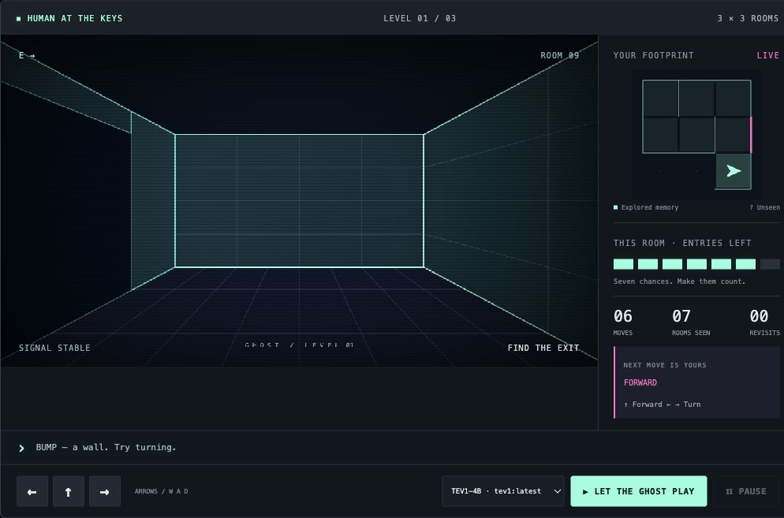

# Clearer observations in actual gameplay

This follow-up promotes the earlier diagnostic's plain-language front/left/right labels into the real game. `relativeEdges` is appended to the existing observation, using only current observed NESW edges and orientation. The same compact memory, question instructions, criterion descriptions and finite action order remain. No unseen topology, computed route or solver action is added.

Both models replay the same nine normal cases: seeds **1983, 1986 and 2026**, at levels **3×3, 4×4 and 6×6**, with **128 decisions / 120 seconds** per attempt and the existing ten-second provider timeout. Presentation pacing is zero for evaluation. Initial observations, code identities and budgets match across models; subsequent observations differ as their actions diverge.

The maze generator, seven-entry allowance, reducer and baseline policies are unchanged. Initial observations also match the preserved compact trials after removing the new redundant labels. The original results remain in [the compact comparison](model-comparison.md), [its summary](../evidence/model-comparison.json), and the original per-model files. New trials have separate filenames and protocol `ghost-paired-relative-v2`; the evaluator's default output also no longer overwrites the original dataset.

## Actual results

| Observation / model | Escapes | Committed decisions | Moves | Wall rejections | Re-entries | Rooms explored, summed |
|---|---:|---:|---:|---:|---:|---:|
| Compact · 0.8B | 0/9 | 1152 | 4 | 1148 | 0 | 13 |
| Compact · 4B | 1/9 | 616 | 102 | 257 | 80 | 30 |
| Relative · 0.8B | 0/9 | 1152 | 4 | 1148 | 0 | 13 |
| Relative · 4B | 3/9 | 558 | 276 | 105 | 175 | 107 |

4B escaped seeds **1986 / level 1**, **1986 / level 2**, and **2026 / level 2**. Five attempts reached the time bound and one exhausted a room. 0.8B again selected FORWARD on all 1,152 committed decisions. No seed or maze was selected in response to these outcomes.

| Seed / level | 0.8B: reason · moves / collisions | 4B: reason · moves / collisions |
|---|---|---|
| 1983 / 1 | DECISION_LIMIT · 0 / 128 | TIME_LIMIT · 40 / 18 |
| 1983 / 2 | DECISION_LIMIT · 0 / 128 | TIME_LIMIT · 45 / 12 |
| 1983 / 3 | DECISION_LIMIT · 0 / 128 | TIME_LIMIT · 39 / 16 |
| 1986 / 1 | DECISION_LIMIT · 0 / 128 | WON · 7 / 2 |
| 1986 / 2 | DECISION_LIMIT · 0 / 128 | WON · 8 / 2 |
| 1986 / 3 | DECISION_LIMIT · 0 / 128 | TIME_LIMIT · 45 / 11 |
| 2026 / 1 | DECISION_LIMIT · 0 / 128 | LOST · 31 / 16 |
| 2026 / 2 | DECISION_LIMIT · 0 / 128 | WON · 14 / 8 |
| 2026 / 3 | DECISION_LIMIT · 4 / 124 | TIME_LIMIT · 47 / 20 |

The clearer labels helped this 4B installation explore and reduced collisions, but did not solve navigation reliably. It made 175 room re-entries; the original observation-only Explorer remains the simple 9/9 reference. In the timed-out 1983 3×3 attempt, all nine rooms and an exit were observed, yet it did not escape. Finding an opening locally is easier than using the retained map to navigate to it. This is an inference from the recorded behavior, not a claim about the model’s internal reasoning.

Median/max latency for committed decisions: **0.8B 8 / 770 ms**, **4B 1,299 / 3,953 ms**. Compare the original **7 / 1,326 ms** and **946.5 / 5,156 ms** cautiously: repeated wall observations offer more prompt reuse, richer exploration changes input sizes, and these local timings are not an isolated speed benchmark. In a time-limited run, one in-flight query may be cancelled without a committed action record; these latency and decision totals describe committed actions. No provider/schema failure was substituted with a solver action.

All actions and outcomes are in [0.8B trials](../evidence/relative-08b.json) and [4B trials](../evidence/relative-4b.json); [the paired summary](../evidence/relative-model-comparison.json) and [cross-encoding controls](../evidence/relative-controls.json) retain the checks. Old result files remain unchanged.

## Menu and movement

The menu now contains **AI · tev1:0.8b** and **TEV1-4B · tev1:latest**, alongside Explorer and Random. The installed large variant reports 4.2B / mxfp8; the small variant reports 752M / BF16. Both model identities and digests are retained with the trials. Different sizes and quantizations, one run per case and ordinary desktop activity limit any general performance claim.

Choosing 4B selects a second binding of the existing native TPF Decision Query. Distinct typed branches join the same validation, deterministic reducer and frame-publication Command. A Play segment remains one root with bounded internal turns; selection creates no extra per-turn roots or custom model client. Both branches have genuine provider integration tests and native lineage samples.

A successful forward step now has a 220 ms approach and small footstep bob inside the newly committed room. Collisions remain in place. Turn animation, map orientation and reduced-motion support remain. Reset or a subsequent transition cancels pending presentation; animation changes no rules or authoritative position.



## Reproduce

Start Ollama with both separately downloaded models, then run from the repository root. Stop any existing game server before starting the evaluation configuration. Keep the evaluation session free of interaction. The two model trials use the same application process; no model reconfiguration or server restart is needed between them.

```sh
ollama pull tev1:0.8b
ollama pull tev1:latest   # Verify this is the intended 4B variant.
GHOST_PACE_MS=0 ./scripts/run.sh

# Another terminal; run these sequentially:
GHOST_PACE_MS=0 python3 scripts/evaluate.py --players TEV1 --runtime app/target/quarkus-app --out evidence/relative-08b.json
GHOST_PACE_MS=0 python3 scripts/evaluate.py --players TEV1_4B --runtime app/target/quarkus-app --out evidence/relative-4b.json
python3 scripts/compare-models.py evidence/relative-08b.json evidence/relative-4b.json --out evidence/relative-model-comparison.json
python3 scripts/test-comparison.py
node scripts/test-renderer.cjs
python3 scripts/verify-replay.py evidence/replay-relative
```

Live timing and later choices can differ. Replaying saved actions is deterministic and must be labelled as replay. A failed or timed-out escape remains a result; there is no successful-route substitution. Native outer-timeout exports may contain partial lifecycles, as already documented; complete bounded provider samples are checked separately.
